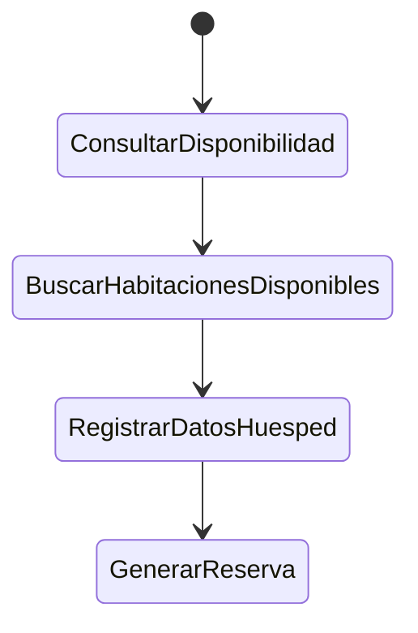
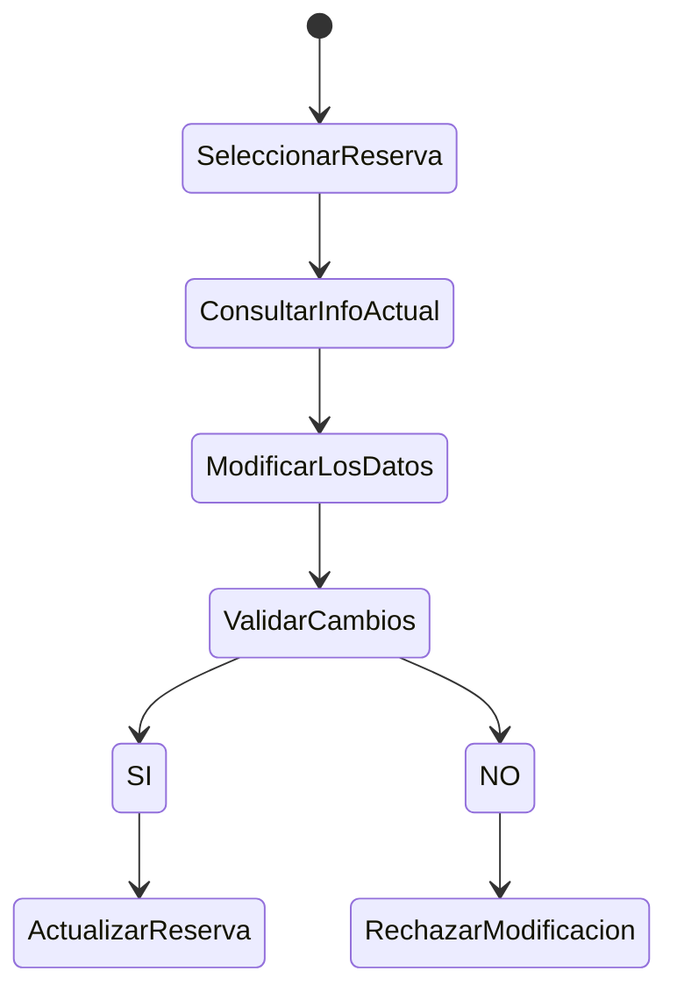
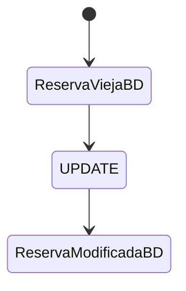
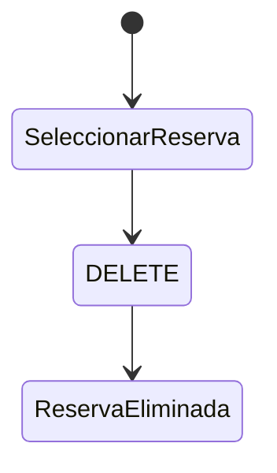
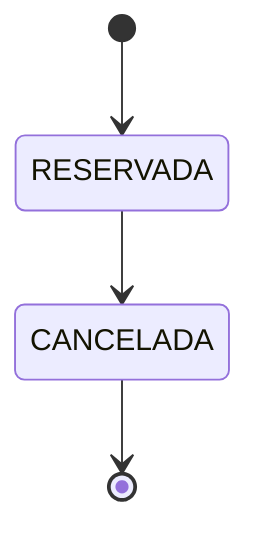

# Sistema de Reservas de Hostel

Trabajo Final de **Programación 2** · Instituto Superior Del Milagro

> Este README es la **documentación viva** del proyecto: acá se registra qué se hizo, qué falta y por qué se tomaron las decisiones. Se actualiza a medida que avanza el trabajo.

| Dato | Detalle |
|---|---|
| Materia | Programación 2 |
| Integrantes | _Erazo Baltazar y Costilla Bruno_ |
| Proceso modelado | Gestionar Reserva |
| Entrega límite | 09/11/2026, 23:59 hs |
| Exposición | Desde el 11/11/2026 |
| Tecnologías, herramientas y conceptos utilizados | Python 3.12.0, MySQL 8.0.46, Aiven, PyQt, Logging, Pathlib, Pandas, Matplotlib, Variables de entorno, Dependencias, DBeaver|
| Formato de backups y reportes | JSON |

---

## Índice

1. [Narrativa descriptiva](#1-narrativa-descriptiva)
2. [Descripción del proceso](#2-descripción-del-proceso)
3. [Actores](#3-actores)
4. [Flujo del proceso](#4-flujo-del-proceso)
   - [4.1 Crear una reserva](#41-crear-una-reserva)
   - [4.2 Modificar una reserva](#42-modificar-una-reserva)
   - [4.3 Actualizar una reserva](#43-actualizar-una-reserva)
   - [4.4 Eliminar una reserva](#44-eliminar-una-reserva)
   - [4.5 Estados de la reserva](#45-estados-de-la-reserva)
5. [Reglas del negocio](#5-reglas-del-negocio)
6. [Modelado de datos](#6-modelado-de-datos)
   - [6.1 Diagrama Entidad-Relación (DER)](#61-diagrama-entidad-relación-der)
   - [6.2 Derivación de tablas normalizadas](#62-derivación-de-tablas-normalizadas)
   - [6.3 Diagrama de Flujo de Datos (DFD)](#63-diagrama-de-flujo-de-datos-dfd)
   - [6.4 Diagrama de Clases (DCD)](#64-diagrama-de-clases-dcd)
7. [Estructura del proyecto](#7-estructura-del-proyecto)
8. [Instalación y ejecución](#8-instalación-y-ejecución)
9. [Bitácora de avances](#9-bitácora-de-avances)
10. [Decisiones de diseño](#10-decisiones-de-diseño)
11. [Lista de pendientes](#11-lista-de-pendientes)

---

## 1. Narrativa descriptiva

## Vista de Gestión de Reservas en Hostales

### ¿Por qué nació la vista?

En la recepción de un hostal, el manejo manual o desorganizado de las reservas colapsa la atención y genera errores críticos en el mostrador. Los principales problemas que motivaron el desarrollo de esta vista específica para el recepcionista son:

- *El riesgo inminente de sobre reserva:* Al no contar con una validación automatizada en pantalla, es fácil asignar una misma habitación a dos huéspedes distintos para las mismas fechas.
- *Demoras en la atención cara a cara:* Buscar una reserva hojeando cuadernos o planillas lentas hace esperar al viajero recién llegado.
- *Errores al modificar o calcular estancias:* Ajustar fechas de última hora o calcular los costos de forma manual bajo presión genera confusiones y cuentas incorrectas.
- *Pérdida de control del inventario de habitaciones:* No saber con certeza inmediata qué espacios están libres, ocupados o bloqueados por cancelaciones.

## 2. Descripción del proceso

El sistema modela **un único proceso** de un hostel: la **gestión de la reserva de uno o muchos huéspedes**.

Permite registrar a un huésped o más huéspedes, consultar qué habitaciones están disponibles para unas fechas y una cantidad de personas, crear la reserva, modificarla y cancelarla. Además, genera estadísticas sobre las reservas para ayudar a la gestión del hostel (ocupación e ingresos).

**Objetivos**

- Evitar reservas duplicadas o superpuestas para una misma habitación.
- Calcular automáticamente el precio de la estadía según el tipo de habitación.
- Mantener un registro ordenado de huéspedes y reservas.
- Ofrecer un panel (dashboard) con indicadores para la toma de decisiones.

## 3. Actores

| Actor | Rol |
|---|---|
| **Recepcionista / administrador** | Usa el sistema: busca disponibilidad, carga huéspedes y reservas, cancela y consulta reportes. |
| **Cliente** | Persona que solicita la reserva. Aporta sus datos, pero no usa el sistema directamente. |

## 4. Flujo del proceso

### 4.1 Crear una reserva



### 4.2 Modificar una reserva



### 4.3 Actualizar una reserva



### 4.4 Eliminar una reserva



### 4.5 Estados de la reserva



## 5. Reglas del negocio

1. La fecha de egreso debe ser posterior a la fecha de ingreso.
2. No se pueden crear reservas con fecha de ingreso en el pasado.
3. Una habitación no puede tener dos reservas activas que se superpongan en fechas.
4. La cantidad de personas no puede superar la capacidad de la habitación.
5. Un huésped se identifica por un ID único.
6. Una reserva cancelada no se elimina: se conserva con su estado.
7. No se puede eliminar un huésped ni una habitación que tengan reservas asociadas.
8. Los atributos como nombre y apellidos solo se pediran atomicamente.
9. Una habitación solo puede tener las siguientes capacidades (camas): 1, 2, 3 y 4

## 6. Modelado de datos

### 6.1 Diagrama Entidad-Relación (DER)


**Borrador de entidades**:

| Entidad | Atributos principales |
|---|---|
| `CLIENTES` | id_cilente, nombre, apellido, dni, telefono, correo |
| `HUESPEDES` | id_huesped, nombre, apellido, dni, telefono |
| `HABITACIONES` | id_habitacion, numero, capacidad, precio_noche, estado |
| `RESERVAS` | id_reserva, fecha_reserva, fecha_ingreso, fecha_salida, estado, monto_total, id_cliente |
| `RESERVAS_X_HUESPEDES` | id_res_x_hue, id_reserva, id_huesped |
| `RESERVAS_X_HABITACIONES` | id_res_x_hab, id_reservas, id_habitacion |

### 6.2 Derivación de tablas normalizadas

Tablas resultantes de pasar el DER a 3FN, con datos de ejemplo para ver cómo quedan cargadas. **PK** indica clave primaria y **FK** clave foránea. Los datos son ficticios.

#### 1. CLIENTES

| id_cliente | nombre | apellido | dni | telefono | correo |
|---|---|---|---|---|---|
| PK | | | | | |
| 1 | Martín | Gómez | 30123456 | 387-4112233 | martin.gomez@example.com |
| 2 | Sofía | Álvarez | 28456789 | 387-4556677 | sofia.alvarez@example.com |

#### 2. HUESPEDES

| id_huesped | nombre | apellido | dni | telefono |
|---|---|---|---|---|
| PK | | | | |
| 1 | Lucía | Pérez | 40111222 | 387-4001122 |
| 2 | Tomás | Ruiz | 41222333 | 387-4002233 |
| 3 | Camila | Díaz | 42333444 | 387-4003344 |
| 4 | Julián | Torres | 39444555 | 387-4004455 |
| 5 | Valentina | Cruz | 38555666 | 387-4005566 |
| 6 | Mateo | Silva | 37666777 | 387-4006677 |

#### 3. HABITACIONES

| id_habitacion | numero | capacidad | precio_noche | estado |
|---|---|---|---|---|
| PK | | | | |
| 1 | 101 | 4 | 18000.00 | DISPONIBLE |
| 2 | 102 | 2 | 25000.00 | OCUPADA |
| 3 | 201 | 6 | 40000.00 | DISPONIBLE |
| 4 | 202 | 2 | 22000.00 | DISPONIBLE |

#### 4. RESERVAS

| id_reserva | fecha_reserva | fecha_ingreso | fecha_salida | estado | monto_total | id_cliente |
|---|---|---|---|---|---|---|
| PK | | | | | | FK → CLIENTES |
| 1 | 2026-10-30 | 2026-11-10 | 2026-11-13 | RESERVADA | 54000.00 | 1 |
| 2 | 2026-11-01 | 2026-11-15 | 2026-11-17 | RESERVADA | 86000.00 | 2 |
| 3 | 2026-11-02 | 2026-11-25 | 2026-11-27 | CANCELADA | 80000.00 | 1 |

#### 5. RESERVAS_X_HUESPEDES

| id_res_x_hue | id_reserva | id_huesped |
|---|---|---|
| PK | FK → RESERVAS | FK → HUESPEDES |
| 1 | 1 | 1 |
| 2 | 1 | 2 |
| 3 | 1 | 3 |
| 4 | 2 | 4 |
| 5 | 2 | 5 |
| 6 | 2 | 6 |
| 7 | 3 | 1 |

#### 6. RESERVAS_X_HABITACIONES

| id_res_x_hab | id_reserva | id_habitacion |
|---|---|---|
| PK | FK → RESERVAS | FK → HABITACIONES |
| 1 | 1 | 1 |
| 2 | 2 | 1 |
| 3 | 2 | 2 |
| 4 | 3 | 3 |

### 6.3 Diagrama de Flujo de Datos (DFD)

_(Pendiente: DFD nivel 0 y nivel 1. Guardar como `docs/dfd_nivel0.png` y `docs/dfd_nivel1.png`.)_

<!-- Cuando esté listo, descomentar:


-->

**Elementos a considerar**

- Entidades externas: recepcionista, huésped.
- Procesos: consultar disponibilidad, registrar huésped, crear reserva, modificar reserva, cancelar reserva, generar reportes.
- Almacenes de datos: habitaciones, huéspedes, reservas.

### 6.4 Diagrama de Clases (DCD)


## 7. Estructura del proyecto

```
proceso_reserva_hostal/
├── backups/
│   ├── storage/
│   └── backup_manager.py
├── certs
│   └──ca.pem
├── core/
│   └── reserva_manager.py
├── dao/
│   ├── db_connection.py
│   └── huesped_dao.py
├── database/
│   ├── init_db.py
│   ├── datos_prueba.sql
│   ├── queries.sql
│   └── schema.sql
├── docs
│   └── img
├── loggers/
│   └── logger_config.py
├── models/
│   ├── clientes.py
│   ├── habitaciones.py
│   ├── huesped.py
│   ├── persona.py
│   └── reservas.py
├── reports/
│   └── analytics.py
├── venv/
├── views/
│   ├── CLI/
│   ├── GUI/
│   └── web/
├── .env
├── .env.example
├── .gitignore
├── LICENSE
├── main.py
└── README.md
└── requirements.txt
```

## 8. Instalación y ejecución

> _Completar a medida que el proyecto avance._

```bash
# 1. Clonar el repositorio
git clone <URL-del-repositorio>
cd hostel

# 2. Crear y activar el entorno virtual
python -m venv venv
source venv/bin/activate          # Mac / Linux
venv\Scripts\activate             # Windows

# 3. Instalar dependencias
pip install -r requirements.txt

# 4. Configurar variables de entorno
cp .env.example .env              # y completar usuario y contraseña de MySQL

# 5. Instala DBeaver, y configura una nueva conexion con los datos del .env

# Aun falta a esto
```

**Pruebas:** `pytest`

## 9. Bitácora de avances

Registrar cada avance con fecha y responsable. Lo más reciente, arriba.

| Fecha | Quién | Qué se hizo | Enlace (commit / PR / archivo) |
|---|---|---|---|
| 28/10/2026 | _Costilla_ | Definición del proceso: gestionar reserva. Creación del README. | — |

## 10. Decisiones de diseño

Anotar acá cada decisión importante y el motivo, para poder explicarlas en la exposición.

| Fecha | Decisión | Motivo |
|---|---|---|
| 28/10/2026 | Modelar solo la gestión de reservas | Alcance acotado para llegar a tiempo con todos los requisitos obligatorios. |
| 28/10/2026 | Backups y reportes en JSON en lugar de CSV | Autorizado por el profesor. |
| 02/11/26 | Los atributos _nombre_, _apellido_ tanto de los Clientes como de los Huespedes seran _atomicos_. Ej: Solo se ingresara un nombre de cliente y un apellido sea de un Cliente o de un Huesped. | Para simplificar la lógica del sistema con relación a los datos.

## 11. Lista de pendientes

Marcar con `[x]` lo que esté terminado y probado.

**Documentación y modelado**
- [x] Definición del proceso a modelar
- [x] Narrativa descriptiva
- [x] Flujo: crear una reserva
- [x] Flujo: modificar una reserva
- [x] Flujo: actualizar una reserva
- [x] Flujo: eliminar una reserva
- [x] Diagrama Entidad-Relación (DER)
- [x] Derivación de las tablas ya normalizadas
- [ ] Diagrama de Flujo de Datos (DFD)
- [x] Diagrama de Clases (DCD)
- [ ] Modificar estructura estructura de carpetas para que cumpla la actual
- [x] Definir las capacidades de cada habitacion y formalizarlas en las reglas de negocio
- [ ] Validar los campos para que cumplan el formato
- [x] Modelar Persona
- [x] Modelar Cliente
- [x] Modelar Huesped
- [x] Modelar Habitación
- [x] Modelar Reservas
- [x] Crear las validaciones de cada modelo
- [ ] Documentación Docstring actualizada
- [ ] Documentación de instalación actualizada
- [ ] Testeo actualiizado
- [ ] Bitacora actualzada

**Base de datos**
- [x] Crear un servidor en la nube
- [x] Crear las tablas
- [x] Tener en cuenta el UNIQUE en las tablas intermedias
- [x] Cargar datos de prueba
- [ ] Configurar variables de entorno.
- [ ] Consulta compleja 1
- [ ] Consulta compleja 2
- [ ] Consulta compleja 3
- [ ] Consulta compleja 4

**Núcleo en Python**
- [x] Logging configurado
- [ ] Logging utilizado completamente
- [ ] Excepciones propias
- [x] Modelos (herencia, polimorfismo, encapsulamiento)
- [x] Conexión a MySQL
- [ ] CRUD de habitaciones
- [ ] CRUD de huéspedes
- [ ] CRUD de reservas
- [ ] Servicios y validaciones

**Reportes y backups**
- [ ] Reportes en JSON y texto
- [ ] Gráficos con Matplotlib
- [ ] Backup en JSON
- [ ] Restauración desde JSON

**GUI**

**Otros**

- [ ] Llenar .env.example para tener la un ejemplo documentado

**Cierre**