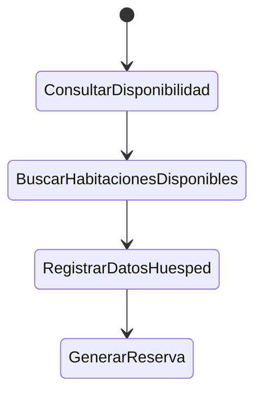
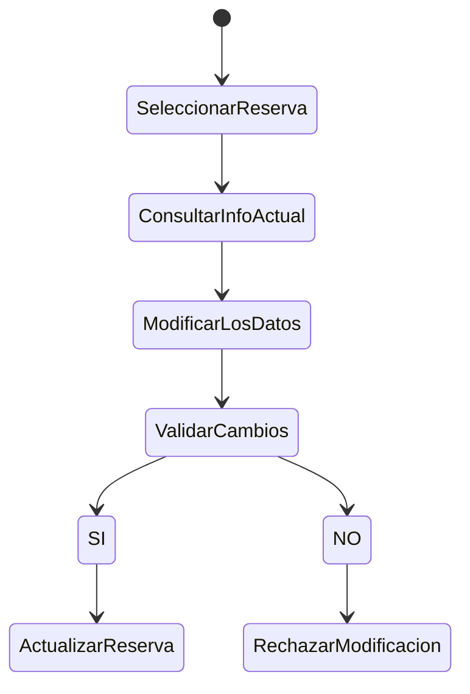
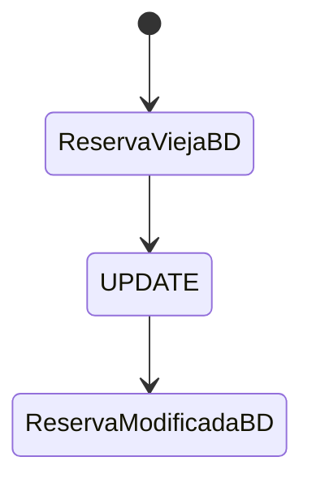
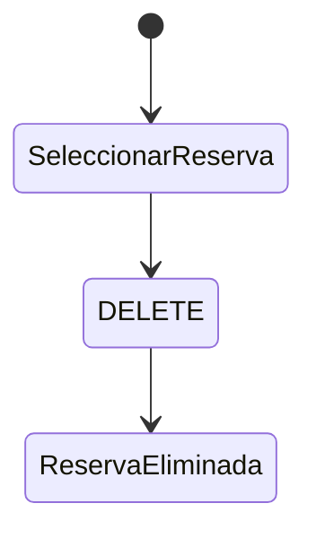
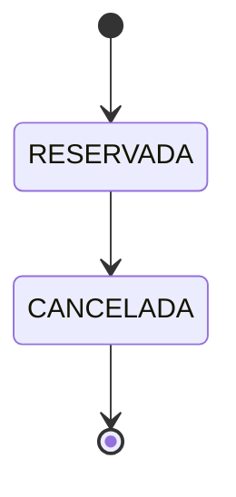
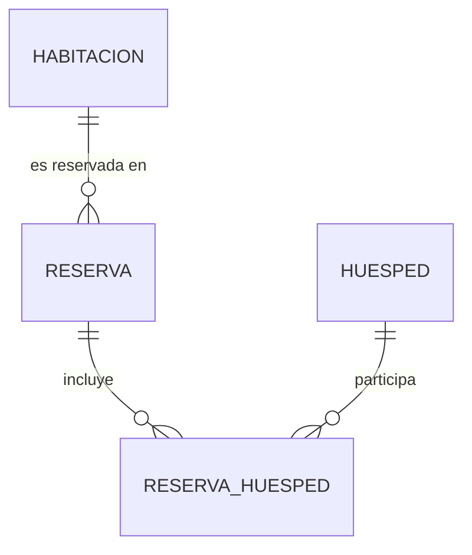

# Sistema de Reservas de Hostel

Trabajo Final de **Programación 2** · Instituto Superior Del Milagro

> Este README es la **documentación viva** del proyecto: acá se registra qué se hizo, qué falta y por qué se tomaron las decisiones. Se actualiza a medida que avanza el trabajo.

| Dato | Detalle |
|---|---|
| Materia | Programación 2 |
| Integrantes | _Erazo Baltazar y Costilla Bruno_ |
| Proceso modelado | Gestionar Reserva |
| Entrega límite | 09/11/2026, 23:59 hs |
| Exposición | Desde el 11/11/2026 |
| Tecnologías | Python, MySQL, (Flask), Pandas, Matplotlib |
| Formato de backups y reportes | JSON |

---

## Índice

1. [Narrativa descriptiva](#1-narrativa-descriptiva)
2. [Descripción del proceso](#2-descripción-del-proceso)
3. [Actores](#3-actores)
4. [Flujo del proceso](#4-flujo-del-proceso)
   - [4.1 Crear una reserva](#41-crear-una-reserva)
   - [4.2 Modificar una reserva](#42-modificar-una-reserva)
   - [4.3 Actualizar una reserva](#43-actualizar-una-reserva)
   - [4.4 Eliminar una reserva](#44-eliminar-una-reserva)
   - [4.5 Estados de la reserva](#45-estados-de-la-reserva)
5. [Reglas del negocio](#5-reglas-del-negocio)
6. [Modelado de datos](#6-modelado-de-datos)
   - [6.1 Diagrama Entidad-Relación (DER)](#61-diagrama-entidad-relación-der)
   - [6.2 Diagrama de Flujo de Datos (DFD)](#62-diagrama-de-flujo-de-datos-dfd)
   - [6.3 Diagrama de Clases (DCD)](#63-diagrama-de-clases-dcd)
7. [Estructura del proyecto](#7-estructura-del-proyecto)
8. [Instalación y ejecución](#8-instalación-y-ejecución)
9. [Bitácora de avances](#9-bitácora-de-avances)
10. [Decisiones de diseño](#10-decisiones-de-diseño)
11. [Lista de pendientes](#11-lista-de-pendientes)

---

## 1. Narrativa descriptiva

_(Pendiente: redactar la narrativa completa, de una a dos páginas, y guardarla en `docs/narrativa.md`. Puede basarse en las secciones 2 a 5.)_

## 2. Descripción del proceso

El sistema modela **un único proceso** de un hostel: la **gestión de la reserva de uno o muchos huéspedes**.

Permite registrar a un huésped o más huéspedes, consultar qué habitaciones están disponibles para unas fechas y una cantidad de personas, crear la reserva, modificarla y cancelarla. Además, genera estadísticas sobre las reservas para ayudar a la gestión del hostel (ocupación e ingresos).

**Objetivos**

- Evitar reservas duplicadas o superpuestas para una misma habitación.
- Calcular automáticamente el precio de la estadía según el tipo de habitación.
- Mantener un registro ordenado de huéspedes y reservas.
- Ofrecer un panel (dashboard) con indicadores para la toma de decisiones.

## 3. Actores

| Actor | Rol |
|---|---|
| **Recepcionista / administrador** | Usa el sistema: busca disponibilidad, carga huéspedes y reservas, cancela y consulta reportes. |
| **Huésped** | Persona que solicita la reserva. Aporta sus datos, pero no usa el sistema directamente. |

## 4. Flujo del proceso

### 4.1 Crear una reserva



### 4.2 Modificar una reserva



### 4.3 Actualizar una reserva



### 4.4 Eliminar una reserva



### 4.5 Estados de la reserva



## 5. Reglas del negocio

1. La fecha de egreso debe ser posterior a la fecha de ingreso.
2. No se pueden crear reservas con fecha de ingreso en el pasado.
3. Una habitación no puede tener dos reservas activas que se superpongan en fechas.
4. La cantidad de personas no puede superar la capacidad de la habitación.
5. Un huésped se identifica por un ID único y por su documento, que no puede repetirse.
6. Una reserva cancelada no se elimina: se conserva con su estado.
7. No se puede eliminar un huésped ni una habitación que tengan reservas asociadas.

> _Completar o ajustar a medida que se definan más reglas._

## 6. Modelado de datos

Los diagramas se guardan como imágenes en `docs/` y se enlazan desde acá.

### 6.1 Diagrama Entidad-Relación (DER)

_(Pendiente: DER definitivo. Guardar como `docs/der.png`.)_

<!-- Cuando esté listo, descomentar:

-->

**Borrador de entidades** (a validar):

| Entidad | Atributos principales |
|---|---|
| `habitacion` | id, numero, tipo (privada/compartida), capacidad, precio_noche |
| `huesped` | id, nombre, apellido, documento, telefono, email, pais |
| `reserva` | id, habitacion_id, fecha_ingreso, fecha_egreso, personas, estado, total |
| `reserva_huesped` (N:M) | reserva_id, huesped_id |



### 6.2 Diagrama de Flujo de Datos (DFD)

_(Pendiente: DFD nivel 0 y nivel 1. Guardar como `docs/dfd_nivel0.png` y `docs/dfd_nivel1.png`.)_

<!-- Cuando esté listo, descomentar:


-->

**Elementos a considerar**

- Entidades externas: recepcionista, huésped.
- Procesos: consultar disponibilidad, registrar huésped, crear reserva, modificar reserva, cancelar reserva, generar reportes.
- Almacenes de datos: habitaciones, huéspedes, reservas.

### 6.3 Diagrama de Clases (DCD)

_(Pendiente: diagrama de clases. Guardar como `docs/diagrama_clases.png`.)_

<!-- Cuando esté listo, descomentar:

-->

**Borrador de clases** (a validar)

- `Habitacion` (clase base) → `HabitacionPrivada`, `HabitacionCompartida`, cada una con su `calcular_precio(noches, personas)` (polimorfismo).
- `Huesped`, `Reserva`.
- Excepciones propias: `HostelError` (base), `DatosInvalidosError`, `ReservaSolapadaError`, `CapacidadExcedidaError`, `RegistroNoEncontradoError`, `ErrorBaseDatos`.

## 7. Estructura del proyecto

```
proceso_reserva_hostal/
├── backups/
│   ├── storage/
│   └── backup_manager.py
├── core/
│   └── reserva_manager.py
├── dao/
│   ├── db_connection.py
│   └── huesped_dao.py
├── database/
│   ├── queries.sql
│   └── schema.sql
├── loggers/
│   └── logger_config.py
├── models/
│   ├── habitaciones.py
│   ├── huesped.py
│   ├── persona.py
│   └── reservas.py
├── reports/
│   └── analytics.py
├── venv/
├── views/
│   ├── CLI/
│   ├── GUI/
│   └── web/
├── .gitignore
├── LICENSE
├── main.py
└── README.md
```

## 8. Instalación y ejecución

> _Completar a medida que el proyecto avance._

```bash
# 1. Clonar el repositorio
git clone <URL-del-repositorio>
cd hostel

# 2. Crear y activar el entorno virtual
python -m venv venv
source venv/bin/activate          # Mac / Linux
venv\Scripts\activate             # Windows

# 3. Instalar dependencias
pip install -r requirements.txt

# 4. Configurar variables de entorno
cp .env.example .env              # y completar usuario y contraseña de MySQL

# 5. Crear la base de datos y cargar los datos de prueba
mysql -u <usuario> -p < sql/crear_tablas.sql
mysql -u <usuario> -p < sql/datos_prueba.sql

# 6. Ejecutar la aplicación
python run.py                     # abre en http://localhost:5000
```

**Pruebas:** `pytest`

## 9. Bitácora de avances

Registrar cada avance con fecha y responsable. Lo más reciente, arriba.

| Fecha | Quién | Qué se hizo | Enlace (commit / PR / archivo) |
|---|---|---|---|
| 28/10/2026 | _Costilla_ | Definición del proceso: gestionar reserva. Creación del README. | — |

## 10. Decisiones de diseño

Anotar acá cada decisión importante y el motivo, para poder explicarlas en la exposición.

| Fecha | Decisión | Motivo |
|---|---|---|
| 28/10/2026 | Modelar solo la gestión de reservas | Alcance acotado para llegar a tiempo con todos los requisitos obligatorios. |
| 28/10/2026 | Backups y reportes en JSON en lugar de CSV | Autorizado por el profesor. |
| 28/10/2026 | Interfaz web con Flask, con JavaScript solo para los gráficos del dashboard | Mantener la lógica en Python y simplificar la parte web. |
| 28/10/2026 | La habitación ocupada se deduce de las reservas, no se guarda como estado | Evita datos duplicados e inconsistencias. |

## 11. Lista de pendientes

Marcar con `[x]` lo que esté terminado y probado.

**Documentación y modelado**
- [x] Definición del proceso a modelar
- [ ] Narrativa descriptiva
- [ ] Flujo: crear una reserva
- [ ] Flujo: modificar una reserva
- [ ] Flujo: actualizar una reserva
- [ ] Flujo: eliminar una reserva
- [ ] Diagrama Entidad-Relación (DER)
- [ ] Diagrama de Flujo de Datos (DFD)
- [ ] Diagrama de Clases (DCD)
- [ ] Estructura de carpetas y configuración

**Base de datos**
- [ ] Script de creación de tablas
- [ ] Datos de prueba
- [ ] Configurar variables de entorno!!!!
- [ ] Consulta compleja 1
- [ ] Consulta compleja 2
- [ ] Consulta compleja 3
- [ ] Consulta compleja 4

**Núcleo en Python**
- [ ] Logging
- [ ] Excepciones propias
- [ ] Modelos (herencia, polimorfismo, encapsulamiento)
- [ ] Conexión a MySQL
- [ ] CRUD de habitaciones
- [ ] CRUD de huéspedes
- [ ] CRUD de reservas
- [ ] Servicios y validaciones

**Reportes y backups**
- [ ] Reportes en JSON y texto
- [ ] Gráficos con Matplotlib
- [ ] Backup en JSON
- [ ] Restauración desde JSON

**GUI**

**Otros**

**Cierre**